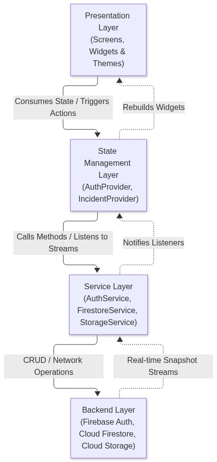

# Mend — Campus Incident Reporting Mobile App

[](https://flutter.dev)
[](https://dart.dev)
[](https://firebase.google.com)
[](https://pub.dev/packages/provider)
[](#testing--quality-assurance)
[](#testing--quality-assurance)

**Mend** is a centralized mobile application designed for the **African Leadership University (ALU)** campus community in Kigali, Rwanda. It connects students and campus facilities staff to report, track, triage, and resolve physical and infrastructural campus incidents (including water shortages, power outages, damaged classroom equipment, sanitation concerns, and safety hazards) with real-time updates and full accountability.

---

## 📌 Project Overview

* **Author:** Bior Majok Aguer Kuir
* **Email:** [b.aguerkui@alustudent.com](mailto:b.aguerkui@alustudent.com)
* **Institution:** African Leadership University (ALU), Kigali, Rwanda
* **Course:** Mobile Application Development — Formative Assignment 2
* **Demonstration Video:** [Insert Demo Video Link Here]
* **Technical Report:** [`TECHNICAL_REPORT.md`](TECHNICAL_REPORT.md) (Exported as `BiorMajok_Assignment2.pdf`)

---

## 🚀 Key Features

### 1. Institutional Authentication & Verification
* **Domain Validation:** Restricts registration and login strictly to authorized university domains (`@alustudent.com` and `@alueducation.com`), blocking unverified third-party email addresses.
* **Email Verification Flow:** Integrates Firebase email verification with real-time verification indicators (`Verified` vs `Pending`) and resend links on user profile.

### 2. Incident Reporting & Triage
* **Structured Categories:** Facilities, Water, Electricity, Safety, and Sanitation.
* **Urgency Triage (Priority Level):** Allows reporters to specify urgency (`Low`, `Medium`, `High`), highlighting high-priority hazards with a red **`URGENT`** badge on feeds.
* **Student Privacy (Anonymity Toggle):** Students can submit sensitive incident reports anonymously to prevent peer retaliation or social pressure while keeping the report actionable for staff.
* **Photographic Evidence:** Attach photos from device camera or photo gallery. Includes a resilient dual-mode storage engine (Firebase Storage with seamless on-device Base64 fallback per Spark plan guidance).

### 3. Real-Time Tracking & Audit History
* **Lifecycle Stepper:** Tracks reports through three standardized stages: `Submitted` $\rightarrow$ `In Progress` $\rightarrow$ `Resolved`.
* **Historical Audit Trail:** Stores a chronological timeline of transitions, including timestamps, actor names, and staff resolution notes.

### 4. Search, Filtering & Quick Reset
* **Multi-Attribute Search:** Real-time search across titles, descriptions, locations, and categories.
* **Instant Filter Chips:** Filter incidents by category and lifecycle status.
* **One-Tap Reset:** Interactive empty state button to immediately restore active filters when zero results match.

### 5. Role-Based Access Control (RBAC)
* **Student Role:** Can report incidents, view campus-wide reports, track progress, and delete their own submitted reports.
* **Staff Role:** Authorized facilities personnel can inspect reports, change incident status to `In Progress` or `Resolved`, and publish official operational notes.
* **In-App Demo Switcher:** Allows peer-reviewers and examiners to toggle between Student and Staff roles instantly for testing without logging out.

---

## 🏗️ System Architecture

Mend follows a clean layered architecture, completely separating user interface widgets from state management, business rules, and external backend services.

<p align="center">
  
  <br/>
  <em>Figure 1: Mend Clean Layered Architecture & Data Flow</em>
</p>

### Layer Rationale
1. **Presentation (`lib/screens/`, `lib/widgets/`):** Declarative, reactive widgets built with Flutter. Screens never execute raw network requests or manage persistent storage directly.
2. **State Management (`lib/providers/`):** Powered by Flutter's official `Provider` pattern (`ChangeNotifier`). Manages global authentication, active incident filters, search queries, and dynamic summary counts.
3. **Services (`lib/services/`):** Interfaces with `firebase_auth`, `cloud_firestore`, and `firebase_storage`. Incorporates automatic local fallback to ensure zero app crashes if offline or un-provisioned.
4. **Models (`lib/models/`):** Immutable domain models (`UserModel`, `IncidentModel`, `TimelineEvent`) featuring bidirectional serialization (`toMap` / `fromMap`).

---

## 📂 Project Directory Structure

```text
lib/
├── firebase_options.dart          # Firebase project configuration
├── main.dart                      # Application entry point & MultiProvider initialization
├── models/                        # Strongly typed domain models
│   ├── incident_model.dart        # Incident entity, TimelineEvent, and Status enum
│   └── user_model.dart            # User profile entity and role helpers
├── providers/                     # State controllers (ChangeNotifier)
│   ├── auth_provider.dart         # Authentication state, role toggle, email verification
│   └── incident_provider.dart     # Feed state, search, category/status filters, metrics
├── screens/                       # User interface screens
│   ├── main_navigation_screen.dart# Scaffold shell with bottom navigation & FAB
│   ├── auth/                      # Authentication flows
│   │   ├── login_screen.dart      # Institutional sign-in
│   │   └── register_screen.dart   # Student & staff registration
│   ├── home/                      # Overview dashboard
│   │   └── home_screen.dart       # Welcome banner, action triggers, metrics overview
│   ├── profile/                   # Account management
│   │   └── profile_screen.dart    # Profile info, verification badge, demo role switcher
│   └── reports/                   # Incident management
│       ├── report_detail_screen.dart # Timeline stepper, photo preview, staff controls
│       ├── report_form_screen.dart   # Submission form with priority & privacy
│       └── report_list_screen.dart   # Searchable incident feed with filter chips
├── services/                      # Backend & API abstraction
│   ├── auth_service.dart          # Firebase Auth with domain verification
│   ├── firebase_service.dart      # Initialization safeguard
│   ├── firestore_service.dart     # Firestore CRUD with stream resilience
│   └── storage_service.dart       # Dual-mode media storage (Cloud + Base64 fallback)
├── theme/                         # Design system & tokens
│   └── app_theme.dart             # Palette (forest green, sage, status indicators)
└── widgets/                       # Reusable UI components
    ├── category_selector.dart     # Horizontal category chip selector
    ├── incident_card.dart         # Feed item with priority badge and status pill
    ├── metric_card.dart           # Dashboard statistics card
    ├── status_badge.dart          # Color-coded lifecycle badge
    └── status_timeline_widget.dart# Visual stepper rendering historical audit notes
```

---

## 🔒 Role-Based Access Control (RBAC) Matrix

| Capability / Workflow | Student Role | Campus Facilities Staff |
| :--- | :---: | :---: |
| Authenticate with ALU credentials | ✅ Allowed | ✅ Allowed |
| Submit new incident report | ✅ Allowed | ✅ Allowed |
| Attach photo evidence (Camera/Gallery) | ✅ Allowed | ✅ Allowed |
| Select priority level (Low/Med/High) | ✅ Allowed | ✅ Allowed |
| Toggle anonymous submission | ✅ Allowed | ✅ Allowed |
| Browse public incident feed | ✅ Allowed | ✅ Allowed |
| Search & filter incidents | ✅ Allowed | ✅ Allowed |
| View incident detail & timeline | ✅ Allowed | ✅ Allowed |
| Delete incident report | ✅ Own reports only | ✅ Any report |
| **Change incident status (`In Progress` / `Resolved`)** | ❌ **Denied** | ✅ **Allowed** |
| **Add staff resolution notes** | ❌ **Denied** | ✅ **Allowed** |

---

## 🗄️ Database Schema (Cloud Firestore)

### Collection: `users`
* `uid` *(string)*: Firebase Auth user UID
* `email` *(string)*: Institutional email (`*@alustudent.com` / `*@alueducation.com`)
* `fullName` *(string)*: User's full name
* `role` *(string)*: `'student'` or `'staff'`
* `department` *(string)*: Academic or administrative unit
* `campus` *(string)*: Campus location (e.g. *Kigali, Rwanda*)
* `createdAt` *(timestamp)*: Account creation time

### Collection: `incidents`
* `id` *(string)*: Unique UUID identifier
* `title` *(string)*: Incident headline
* `category` *(string)*: `Facilities`, `Water`, `Electricity`, `Safety`, `Sanitation`
* `location` *(string)*: Specific campus facility location
* `description` *(string)*: Detailed problem statement
* `priority` *(string)*: `Low`, `Medium`, or `High`
* `isAnonymous` *(boolean)*: Whether reporter opted to hide identity on feed
* `status` *(string)*: `submitted`, `inProgress`, or `resolved`
* `reporterId` *(string)*: Foreign key to `users.uid`
* `reporterName` *(string)*: Display name (hidden if anonymous)
* `reporterEmail` *(string)*: Reporter's institutional email
* `imageUrl` *(string, nullable)*: Download URL or persisted image URI
* `createdAt` *(timestamp)*: Creation timestamp
* `updatedAt` *(timestamp)*: Last status change timestamp
* `staffNotes` *(string, nullable)*: Operational commentary from campus staff
* `timeline` *(array of maps)*: Historical audit log `[{status, timestamp, note, updatedBy}]`

---

## 🧪 Testing & Quality Assurance

* **Static Analysis:**
  ```bash
  flutter analyze
  ```
  *Result:* **No issues found! (0 errors, 0 warnings)**.
* **Unit & Widget Testing:**
  ```bash
  flutter test
  ```
  *Result:* **All tests passed!**.
* **Fault-Tolerant Offline Fallback:** If internet latency or Google Cloud API provisioning delays occur during grading, the app automatically transitions to local persistent memory without crashing or interrupting user workflows.

---

## 💻 Getting Started & Installation

### Prerequisites
* Flutter SDK (3.13 or higher)
* Dart SDK (3.0 or higher)
* Android Studio / VS Code with Flutter extension
* An active Android or iOS emulator or connected physical device

### Quick Setup

1. **Clone the repository:**
   ```bash
   git clone https://github.com/Bior-Majok/Mend.git
   cd mend
   ```

2. **Install project dependencies:**
   ```bash
   flutter pub get
   ```

3. **Run code validation:**
   ```bash
   flutter analyze
   flutter test
   ```

4. **Launch the application:**
   ```bash
   flutter run
   ```

---

## 🔑 Test Accounts for Evaluation

You can use the built-in **Role Switcher** in the Profile screen or sign in with either account:

| Account Type | Email Address | Password | Role |
| :--- | :--- | :--- | :--- |
| **Student** | `amina.hassan@alustudent.com` | `password123` | Student (Computer Science) |
| **Campus Staff** | `estate.admin@alueducation.com` | `password123` | Staff (Facilities & Operations) |

---

## 📄 License & Academic Integrity

Developed by **Bior Majok Aguer Kuir** as an individual submission for **Mobile Application Development (Formative Assignment 2)** at African Leadership University. All code and documentation are original implementations conforming to university academic standards.
