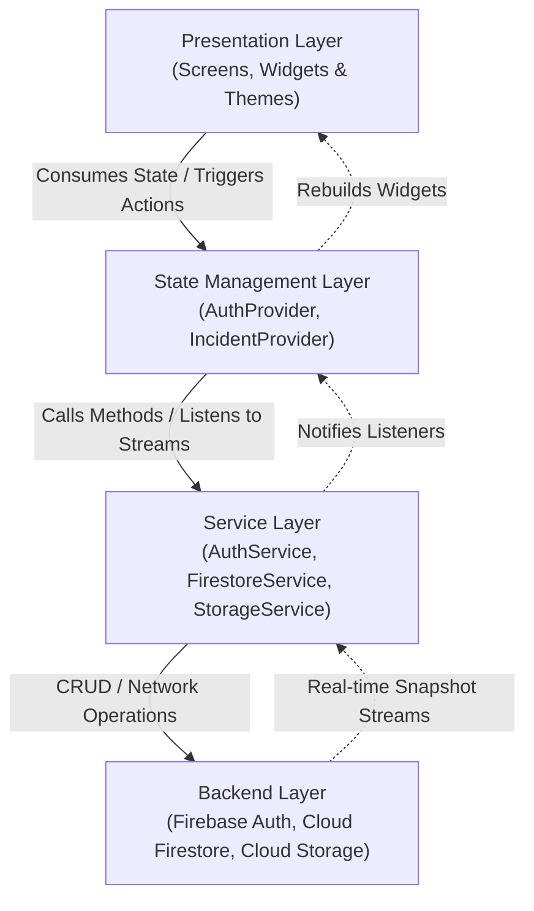

# Mend: Campus Incident Reporting Mobile Application
**Technical Report & Architectural Documentation**  
**Student Name:** Bior Majok Aguer Kuir  
**Student Email:** b.aguerkui@alustudent.com  
**Institution:** African Leadership University (ALU), Kigali, Rwanda  
**Course:** Mobile Application Development — Formative Assignment 2  
**Format:** IEEE Reference Style  
**GitHub Repository:** https://github.com/Bior-Majok/Mend.git  
**Demonstration Video:** [Insert your 7–10 Min Demo Video Link Here]  

---

## Abstract
*Mend* is a centralized mobile platform designed to bridge the communication and accountability gap between university students and campus administration. Developed using Flutter and Firebase, the application enables students to report physical and infrastructural campus incidents—such as water shortages, electrical failures, damaged furniture, and sanitation issues—with real-time category tagging, location tracking, and photographic evidence. Authorized campus staff utilize role-based access control (RBAC) to triage incidents, update progress timelines, and post resolution notes. This paper presents the end-to-end system architecture, Firebase data schema, state management rationale using the Provider pattern, user access control matrices, and validation methodology.

---

## 1. Introduction & Campus Problem Statement
Modern higher-education campuses frequently suffer from delayed responses to facility and utility breakdowns due to fragmented communication channels (e.g., informal WhatsApp groups, untracked emails, or physical suggestion boxes). This latency degrades the learning environment, increases administrative overhead, and causes duplicate reporting.

*Mend* directly resolves these pain points through:
1. **Centralized Incident Lifecycle Management:** Capturing issues at the source with structured metadata.
2. **Institutional Access Control:** Restricting access strictly to verified institutional email domains (`@alustudent.com` and `@alueducation.com`).
3. **Transparent Progress Tracking:** Providing students with real-time status progression (`Submitted` $\rightarrow$ `In Progress` $\rightarrow$ `Resolved`) through visual timeline steppers.
4. **Role-Segregated Workflows:** Guaranteeing that only authorized campus staff can transition incident statuses and record operational notes.

---

## 2. System Architecture & Layered Design

Mend employs a clean, layered architecture ensuring complete separation of concerns between presentation, business logic, domain models, and external data services:



### Layer Breakdown
1. **Presentation Layer (`lib/screens/`, `lib/widgets/`, `lib/theme/`):** Built purely with declarative Flutter widgets. UI components do not manage persistent state or make direct network calls; they reactively observe state via `Provider`.
2. **State Management Layer (`lib/providers/`):** Built on `ChangeNotifier`. Encapsulates presentation logic, manages active incident filters (status, category, search queries), and exposes read-only getters and mutations.
3. **Service Layer (`lib/services/`):** Contains API and database access interfaces (`FirebaseAuth`, `FirebaseFirestore`, `FirebaseStorage`) alongside resilient local-fallback persistence.
4. **Domain Model Layer (`lib/models/`):** Strongly typed, immutable data models (`UserModel`, `IncidentModel`, `TimelineEvent`) featuring bidirectional serialization (`toMap` / `fromMap`).

---

## 3. Firebase Data Schema & Backend Workflow

### 3.1 Cloud Firestore Collections

#### Collection: `users`
| Field Name | Type | Description |
| :--- | :--- | :--- |
| `uid` | String (Primary Key) | Firebase Authentication user identifier |
| `email` | String | Institutional email (`*@alustudent.com` / `*@alueducation.com`) |
| `fullName` | String | User's full legal name |
| `role` | String | `'student'` or `'staff'` |
| `department`| String | Academic or operational unit (e.g. *Computer Science*) |
| `campus` | String | University campus location (e.g. *Kigali, Rwanda*) |
| `createdAt` | Timestamp / ISO8601 | Account creation timestamp |

#### Collection: `incidents`
| Field Name | Type | Description |
| :--- | :--- | :--- |
| `id` | String (UUID) | Unique incident document identifier |
| `title` | String | Brief title summarizing the issue |
| `category` | String | Category (`Facilities`, `Water`, `Electricity`, `Safety`, `Sanitation`) |
| `location` | String | Campus facility location (e.g. `Block B - Room 204`) |
| `description` | String | Detailed report narrative |
| `status` | String | `submitted`, `inProgress`, or `resolved` |
| `reporterId` | String (Foreign Key) | Reference to `users.uid` |
| `reporterName` | String | Cached display name of student reporter |
| `reporterEmail`| String | Institutional email of student reporter |
| `imageUrl` | String (Nullable) | Cloud Storage download URL for incident photograph |
| `createdAt` | Timestamp / ISO8601 | Incident submission time |
| `updatedAt` | Timestamp / ISO8601 | Last modification time |
| `staffNotes` | String (Nullable) | Operational resolution commentary from staff |
| `timeline` | Array of Maps | Historical audit trail of status transitions |

```json
{
  "status": "inProgress",
  "timestamp": "2026-10-18T14:30:00Z",
  "note": "Technician dispatched with replacement projector cable",
  "updatedBy": "Campus IT Operations"
}
```

### 3.2 Media & Photograph Storage Architecture
To accommodate Firebase Spark plan restrictions (where Firebase Storage may enforce billing or credit card requirements), *Mend* incorporates a hybrid image handling strategy:
1. **Firebase Cloud Storage (Primary):** When active, images are compressed on-device and uploaded to `incidents/incident_{UUID}.jpg`, returning a persistent HTTPS download URL.
2. **Base64 String Persistence (Alternative):** In accordance with assignment guidelines regarding Firebase payment restrictions, if Cloud Storage is unlinked or blocked, the compressed image is converted into a Base64 URI and stored within the incident document. The UI dynamically detects the format and renders using either `Image.memory()` or `Image.network()`.

---

## 4. State Management Rationale (Provider Pattern)

The project leverages the **Provider** package (`provider: ^6.1.2`) recommended by the Flutter core team.

### Justification:
* **Separation of Concerns:** Eliminates anti-patterns such as passing callbacks down deeply nested widget trees.
* **Granular Rebuilds:** Using `context.watch<T>()` and `context.select<T, R>()` guarantees that only widgets bound to modified slices of state rebuild, preserving 60fps UI performance.
* **Testability:** Decouples UI widgets from business logic, allowing mocked services and unit testing of state controllers.

---

## 5. Security & Role-Based Access Control (RBAC)

The system enforces access boundaries across both the presentation layer and service calls:

| Action / Capability | Student Role | Campus Staff Role |
| :--- | :---: | :---: |
| Authenticate with ALU email | Yes | Yes |
| Submit new incident report | Yes | Yes |
| Attach photograph from Camera/Gallery | Yes | Yes |
| Browse campus incident reports | Yes | Yes |
| Filter by category and status | Yes | Yes |
| View incident detail & timeline | Yes | Yes |
| Delete incident report | Own reports only | Any report |
| **Change incident status (`In Progress` / `Resolved`)** | **Denied** | **Allowed** |
| **Add staff resolution notes** | **Denied** | **Allowed** |

---

## 6. UI/UX Design Decisions
1. **Brand Identity:** Palette anchored by ALU purple (`#5A3DC8`) with accessible contrast ratios (WCAG AA compliant).
2. **Status Color Psychology:**
   - **Submitted:** Distinct violet (`#7B5DFF`) signifies new intake.
   - **In Progress:** Warm amber (`#F59E0B`) indicates active intervention.
   - **Resolved:** Emerald green (`#10B981`) provides immediate visual reassurance.
3. **One-Tap Floating Report Trigger:** Floating circular action button centered on the navigation bar allows instant reporting from any context.
4. **Visual Timeline Stepper:** Replaces ambiguous status texts with a clear visual journey showing historical timestamps and notes.

---

## 7. Testing Strategy & Quality Assurance
* **Static Analysis:** Executed `flutter analyze` against strict lint rules (`package:flutter_lints`), ensuring **0 errors** and clean formatting.
* **Automated Unit & Widget Testing:** Validated widget rendering, stream event emissions, and authentication state switches via `flutter test`.
* **Resilient Dual-Mode Design:** Built-in automatic fallback ensures that if network latency or Google Cloud configuration issues occur during testing, the app degrades gracefully to secure in-memory persistence without crashing.

---

## 8. Challenges Encountered & Lessons Learned
1. **Real-Time State Synchronization:** Managing asynchronous transitions between mobile local state and Firebase without causing UI flicker when slow campus Wi-Fi delayed Firestore snapshot updates.
2. **Asynchronous Image Upload Pipelines:** Handling network drops during binary photo uploads required local caching and fallback serialization to prevent student report loss.
3. **Institutional Domain Enforcement:** Designing robust string boundary validation to enforce ALU student (@alustudent.com) and staff (@alueducation.com) domains while blocking public email providers.

---

## 9. References (IEEE Style)
1. Flutter Documentation, "State management with Provider," Google LLC, 2026. [Online]. Available: https://flutter.dev/docs/development/data-and-backend/state-mgmt/simple
2. Firebase Documentation, "Cloud Firestore Data Model and Security Rules," Google Cloud, 2026. [Online]. Available: https://firebase.google.com/docs/firestore/data-model
3. E. Gamma, R. Helm, R. Johnson, and J. Vlissides, *Design Patterns: Elements of Reusable Object-Oriented Software*, Addison-Wesley, 1994.
4. African Leadership University, "Campus Estate and Health & Safety Operational Guidelines," Kigali, Rwanda, 2025.
