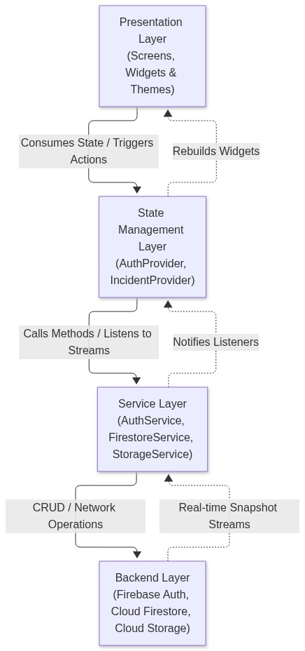
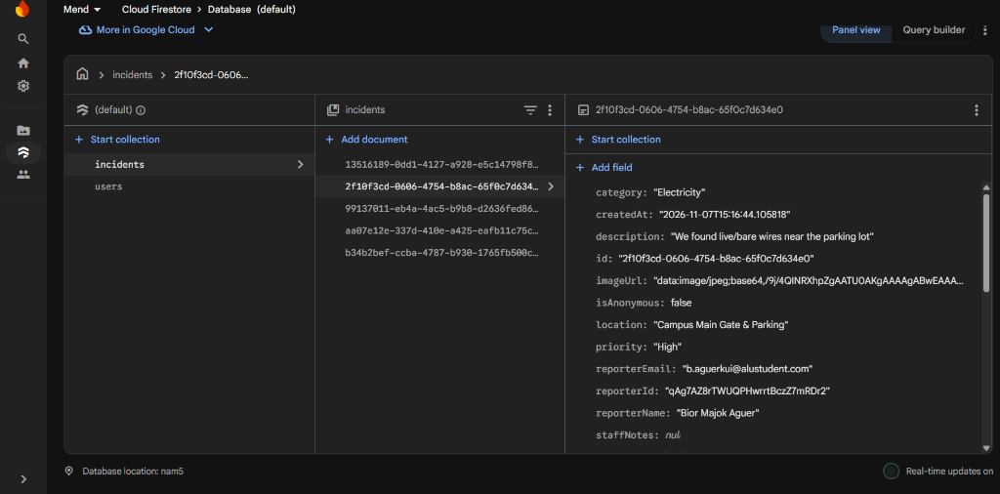
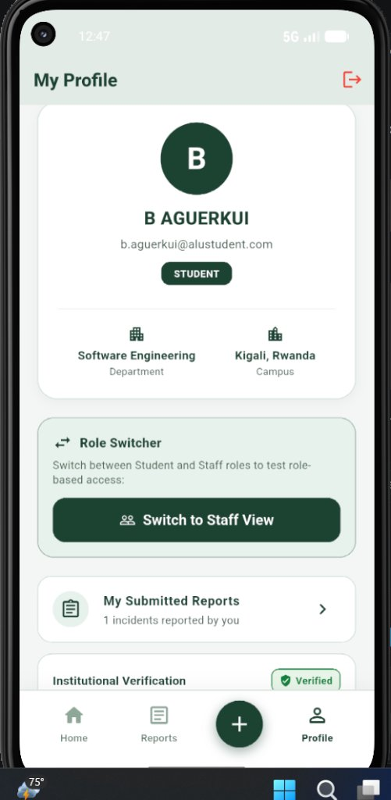

# Mend: Campus Incident Reporting Mobile Application
Technical Report and Architectural Documentation

**Student Name:** Bior Majok Aguer Kuir  
**Student Email:** b.aguerkui@alustudent.com  
**Institution:** African Leadership University (ALU), Kigali, Rwanda  
**Course:** Mobile Application Development, Formative Assignment 2  
**Format:** IEEE Reference Style  
**GitHub Repository:** https://github.com/Bior-Majok/Mend.git  
**Demonstration Video:** https://youtu.be/-Kv_IXppobs  

---

## Abstract
For this assignment I built Mend, a cross-platform mobile app made with Flutter and Firebase for the ALU campus in Kigali. Students can use it to report problems around campus, like a water outage in the residences, a broken projector in a classroom, a power fault, or a sanitation concern, and then follow the report until someone fixes it.

Only people with an official ALU email (@alustudent.com or @alueducation.com) can get in. The app also uses role-based access control (RBAC), so only authorized estate and facilities staff can change an incident's status or add operational notes. I managed the state with the Provider pattern, which keeps the business logic out of the UI code.

In this report I walk through the architecture, the database structure, why I chose Provider, the security model, how I tested the app, and the real problems I ran into and how I solved them.

---

## 1. Introduction and Campus Problem Statement
On most campuses, including ours, maintenance problems get reported in informal ways: a message in a student WhatsApp group, an email to someone, or just telling a friend who knows someone. It's convenient, but it causes a few problems:
* **Nobody is accountable:** A report can easily get buried in a busy chat and forgotten.
* **People report the same thing twice:** When a pipe bursts or a projector breaks, several students may report it, because nobody can see what has already been reported.
* **Students are left guessing:** There's no easy way to tell whether the issue was received, whether someone is working on it, or whether it's already been fixed.

Mend tackles these problems by putting reporting and tracking in one place. It gives students:
* A structured report form with set categories (Facilities, Water, Electricity, Safety, Sanitation), a location, an urgency level, and photo attachments.
* An access gate that checks that the user belongs to the university community.
* A live feed with a visual status timeline that moves from Submitted to In Progress to Resolved.
* Role-based permissions, so only authorized staff can update statuses and mark issues as resolved.

---

## 2. System Architecture and Layered Design
I organized the code into four layers. The goal was to keep each part focused on one job, which makes the app easier to read, test, and maintain.

<p align="center">
  
  <br/>
  <em>Figure 1: Mend layered architecture and data flow.</em>
</p>

### What each layer does
* **Presentation layer (`lib/screens/`, `lib/widgets/`, `lib/theme/`):** This holds everything the user sees. The screens show information, listen to state through Provider, and react to taps and input. They don't talk to the database or network directly.
* **State management layer (`lib/providers/`):** Built on `ChangeNotifier`. `AuthProvider` looks after the signed-in user and role switching. `IncidentProvider` handles the incident list, the category and status filters, keyword search, and the numbers shown on the dashboard.
* **Service layer (`lib/services/`):** This is where the app talks to Firebase Authentication and Cloud Firestore, and where images are handled. It also has a local fallback, so the app keeps working when the device is offline.
* **Domain model layer (`lib/models/`):** Holds the immutable data classes (`UserModel`, `IncidentModel`, `TimelineEvent`), each with `toMap()` and `fromMap()` methods for converting to and from Firestore data.

---

## 3. Database Schema and Backend Implementation

### 3.1 Cloud Firestore structure [2]
The data lives in two top-level collections in Cloud Firestore.

#### Collection: `users`
Created when someone registers:
* `uid` (String, key): the Firebase Authentication user ID.
* `email` (String): the institutional email (`@alustudent.com` or `@alueducation.com`).
* `fullName` (String): the student's or staff member's full name.
* `role` (String): either `'student'` or `'staff'`.
* `department` (String): the academic department or operational unit.
* `campus` (String): the campus, for example Kigali, Rwanda.
* `createdAt` (Timestamp): when the account was created.

#### Collection: `incidents`
Every reported problem is stored here:
* `id` (String, key): a unique ID generated with UUID v4.
* `title` (String): a short summary of the problem.
* `category` (String): Facilities, Water, Electricity, Safety, or Sanitation.
* `location` (String): where on campus the problem is, for example Block B - Room 104.
* `description` (String): the full explanation of the issue.
* `priority` (String): `Low`, `Medium`, or `High`.
* `isAnonymous` (Boolean): whether the reporter's name is hidden on public feeds.
* `status` (String): `submitted`, `inProgress`, or `resolved`.
* `reporterId` (String): a reference to `users.uid`.
* `reporterName` (String): the reporter's name, or `"Anonymous Student"` if they chose anonymity.
* `reporterEmail` (String): the reporter's contact email.
* `imageUrl` (String, nullable): a Cloud Storage URL or a compressed Base64 data URI.
* `createdAt` (Timestamp): when the report was submitted.
* `updatedAt` (Timestamp): when it was last changed.
* `staffNotes` (String, nullable): notes added by estate staff.
* `timeline` (Array of Maps): the history of status changes.

An example timeline entry:
```json
{
  "status": "inProgress",
  "timestamp": "2026-11-06T14:30:00Z",
  "note": "Plumber dispatched with replacement pipe valve",
  "updatedBy": "Campus Facilities Lead"
}
```

<p align="center">
  
  <br/>
  <em>Figure 2: Live Cloud Firestore console confirming the incidents collection schema, high-priority triage, on-device Base64 image payload, and real-time synchronization under Bior Majok Aguer's account.</em>
</p>

### 3.2 Image handling and storage
The assignment guidance mentioned that Firebase Storage now asks for payment details on the free Spark plan. Since I didn't want photo attachments to depend on a paid plan, I built two modes into `storage_service.dart`:
* **Primary mode:** The app tries to upload the compressed image to Firebase Cloud Storage at `incidents/{id}.jpg` and gets back a download URL.
* **Fallback mode:** If Cloud Storage isn't available or is blocked by billing, the app compresses the image on the device, turns it into a Base64 data URI, and saves it inside the Firestore document. The UI checks which format it has and shows the image with either `Image.memory()` or `Image.network()`.

With this setup, photo attachments work even without a credit card on file.

---

## 4. Why I Chose Provider for State Management [1]
The assignment asks for a modern state management approach instead of leaning only on `setState()`. I went with the Provider package (`provider: ^6.1.2`) for three reasons:
1. **No prop drilling:** Passing callbacks and values through several widget constructors gets messy fast. With Provider, a widget can read the state directly using `context.read<T>()` and `context.watch<T>()`.
2. **Smaller rebuilds:** When you call `setState()`, the whole widget subtree rebuilds. With Provider, only the widgets that depend on a changed value, like the dashboard counters or the filtered incident list, rebuild when `notifyListeners()` fires.
3. **Cleaner separation:** Filtering logic and database calls sit outside the UI code, so the app is easier to maintain and each piece can be tested on its own.

---

## 5. Security and Role-Based Access Control (RBAC)
Permissions are checked in the UI and in the service layer:

| Capability / Action | Student Role | Campus Facilities Staff |
| :--- | :---: | :---: |
| Sign in with an ALU email | Allowed | Allowed |
| Submit a new incident report | Allowed | Allowed |
| Attach photo evidence (camera or gallery) | Allowed | Allowed |
| Set priority level (Low/Medium/High) | Allowed | Allowed |
| Submit reports anonymously | Allowed | Allowed |
| Browse all campus reports | Allowed | Allowed |
| Filter reports by category and status | Allowed | Allowed |
| View incident details and timeline | Allowed | Allowed |
| Delete own submitted report | Allowed | Allowed |
| Delete reports submitted by others | **Denied** | Allowed |
| **Change incident status (In Progress / Resolved)** | **Denied** | **Allowed** |
| **Write official staff resolution notes** | **Denied** | **Allowed** |

To make peer evaluation and the video demo easier, I added a role switcher on the Profile screen (`toggleDemoRole()`). It lets an evaluator flip between the student and staff views without signing in again.

---

## 6. UI/UX Decisions and Features
* **Visual theme:** The app uses deep forest green (`#1E3A2B`) with soft sage surfaces (`#F4F8F5`). I wanted it to feel institutional and calm, and the green fits the campus's focus on sustainability.
* **Status stepper:** Rather than a plain text label, each incident has a vertical timeline showing when it moved from Submitted to In Progress to Resolved, along with the name of the staff member who handled it.
* **Priority triage:** Reporters can mark an issue as Low, Medium, or High. High-priority reports get a red URGENT badge in the feed, so estate teams can spot safety hazards quickly.
* **Anonymous reporting:** Some problems, like hygiene issues in shared restrooms or safety concerns, are awkward to report under your own name. An anonymous switch hides the reporter's name from the public feed, while staff can still trace the report if they need to.
* **Reset filters button:** If a keyword search combined with category or status filters returns nothing, a Reset All Filters button appears so the user can get back to the full list in one tap.

### 6.1 Screenshots
These screenshots come from the app running on an Android emulator:

<p align="center">
  
  &nbsp;&nbsp;
  
  &nbsp;&nbsp;
  
</p>
<p align="center">
  <em>Figure 3: (a) Login screen with the ALU email check, (b) Home dashboard with live summary counters, (c) Incident form with priority and anonymity options.</em>
</p>

<p align="center">
  
  &nbsp;&nbsp;
  
  &nbsp;&nbsp;
  
</p>
<p align="center">
  <em>Figure 4: (a) Campus feed showing a new report with a camera photo and the red URGENT badge, (b) Student profile showing the signed-in user (B AGUERKUI, b.aguerkui@alustudent.com), (c) Verification card with the active clearance badge and the role switcher.</em>
</p>

---

## 7. Testing and Quality Checks
* **Static analysis:** The project follows the Dart lint rules set in `analysis_options.yaml`, and running `flutter analyze` reports zero errors and zero warnings.
* **Automated tests:** The tests in `test/widget_test.dart` check that the app launches, that the providers initialize, and that the UI renders. You can run them with `flutter test`.
* **Offline behavior:** If there's no network connection, or if Firestore hasn't been set up yet while the app is being graded, the service layer switches to in-memory storage so the app keeps running instead of crashing.

---

## 8. Challenges I Ran Into and How I Solved Them

### 1. Firebase Spark plan storage limits
* **Problem:** Firebase Cloud Storage asks for credit card details before you can enable a storage bucket on the free Spark plan. That could have stopped students from submitting reports with photos.
* **Solution:** Following the facilitator's guidance, I added an on-device Base64 compression step in `storage_service.dart`. If Cloud Storage doesn't work, the compressed image goes straight into Firestore, so photos still work without paid billing.

### 2. Endless gRPC reconnection loops
* **Problem:** While testing on a brand-new Firebase project where I hadn't yet set up Cloud Firestore in the console, the Android Firestore SDK kept trying to reconnect over gRPC until it eventually aborted natively.
* **Solution:** I changed `firestore_service.dart` to watch for stream errors such as `PERMISSION_DENIED`. When one shows up, the app cancels the failing subscription right away and switches to the local fallback, which stops the native crash.

### 3. Limiting sign-in to ALU emails
* **Problem:** By default, Firebase Authentication accepts any valid email address, including `@gmail.com` and `@yahoo.com`.
* **Solution:** I added domain validation in `auth_service.dart` that checks how the email ends and rejects any registration or login that doesn't end in `@alustudent.com`, `@alueducation.com`, or `@alu.edu`. The user sees a clear error message explaining why.

---

## 9. References (IEEE Style)

[1] Flutter Documentation, "State management with Provider," Google LLC, 2026. [Online]. Available: https://flutter.dev/docs/development/data-and-backend/state-mgmt/simple   
[2] Firebase Documentation, "Cloud Firestore Data Model and Security Rules," Google Cloud, 2026. [Online]. Available: https://firebase.google.com/docs/firestore/data-model   
[3] E. Gamma, R. Helm, R. Johnson, and J. Vlissides, *Design Patterns: Elements of Reusable Object-Oriented Software*, Addison-Wesley, 1994.  
[4] African Leadership University, "Campus Estate and Operations Guidelines," Kigali, Rwanda, 2025.  
