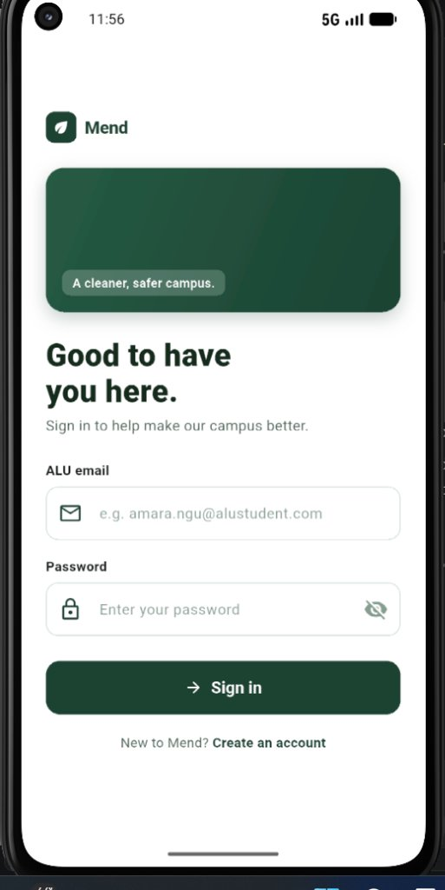
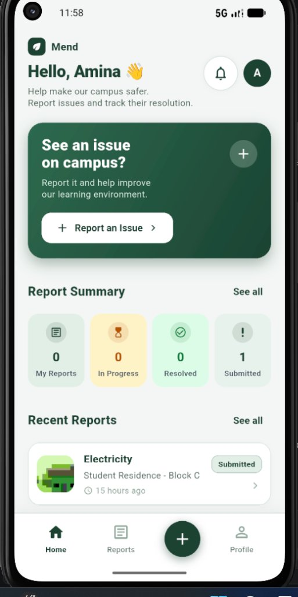
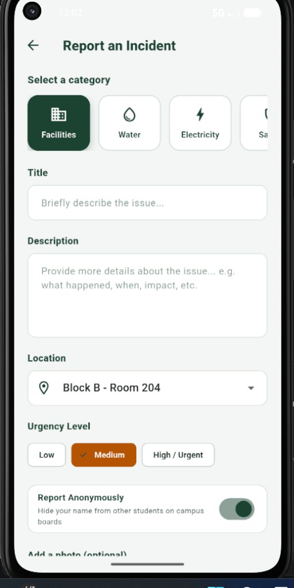
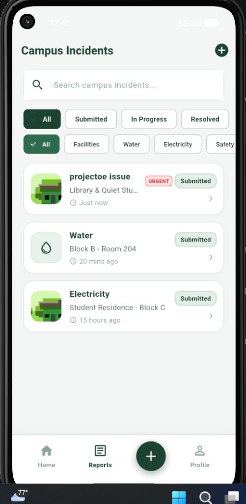
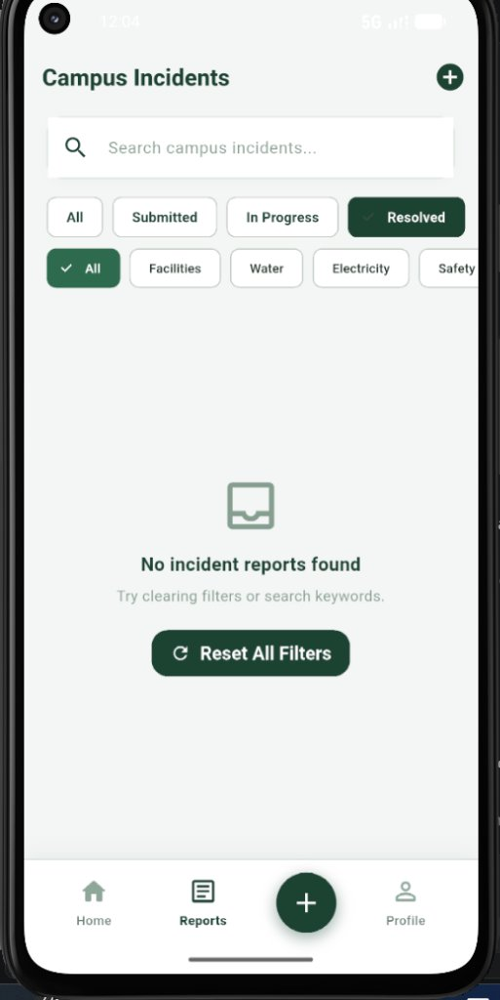
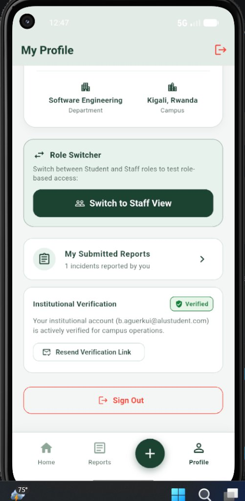

# Mend: Campus Incident Reporting Mobile Application
**Technical Report & Architectural Documentation**  
**Student Name:** Bior Majok Aguer Kuir  
**Student Email:** b.aguerkui@alustudent.com  
**Institution:** African Leadership University (ALU), Kigali, Rwanda  
**Course:** Mobile Application Development — Formative Assignment 2  
**Format:** IEEE Reference Style  
**GitHub Repository:** https://github.com/Bior-Majok/Mend.git  
**Demonstration Video:** [Insert Demo Video Link Here]  

---

## Abstract
In this assignment, I designed and developed *Mend*, a cross-platform mobile application built with Flutter and Firebase for the African Leadership University (ALU) campus in Kigali. The app allows students to report physical campus issues—such as water outages in student residences, broken classroom projectors, power faults, and sanitation concerns—and track them through resolution. To manage access, authentication is restricted to official ALU email accounts (`@alustudent.com` and `@alueducation.com`). The app implements role-based access control (RBAC) so that only authorized estate and facilities staff can update incident statuses and log operational notes. Application state is handled using the Provider pattern to decouple business logic from the user interface. This report documents the architecture, database schema, state management decisions, security model, testing results, and practical challenges solved during development.

---

## 1. Introduction & Campus Problem Statement
At university campuses like ALU, maintenance issues are often reported through informal channels such as student WhatsApp groups, direct emails, or word-of-mouth. This creates several practical problems:
1. **Lack of accountability:** Issues are frequently forgotten or lost in chat feeds.
2. **Duplicate reporting:** Multiple students report the same broken facility (e.g., a burst pipe or broken projector) because there is no central visibility.
3. **No progress updates:** Students have no way of knowing whether an issue has been received, is being worked on, or has already been resolved by campus technicians.

*Mend* directly addresses these challenges by providing:
* A structured incident reporting form with predefined categories (Facilities, Water, Electricity, Safety, Sanitation), location tags, urgency levels, and photo attachments.
* An institutional access gate that verifies university community membership.
* A live tracking feed with a visual status timeline (`Submitted` -> `In Progress` -> `Resolved`).
* Role-separated permissions ensuring only authorized staff can mark issues as resolved.

---

## 2. System Architecture & Layered Design

I structured the Mend codebase using a four-layer architecture to ensure clean separation of concerns, testability, and maintainability:

<p align="center">
  
  <br/>
  <em>Figure 1: Mend Clean Layered Architecture & Data Flow</em>
</p>

### Layer Responsibilities
1. **Presentation Layer (`lib/screens/`, `lib/widgets/`, `lib/theme/`):** Contains all UI widgets. Screens are strictly declarative; they observe state via Provider and dispatch user actions without performing database or network operations directly.
2. **State Management Layer (`lib/providers/`):** Built on `ChangeNotifier`. `AuthProvider` manages the active user session and role switching. `IncidentProvider` manages the live incident list, active category and status filters, keyword search queries, and summary metrics.
3. **Service Layer (`lib/services/`):** Encapsulates Firebase Authentication, Cloud Firestore, and image handling. It also provides automatic local fallback persistence so that the app remains functional if the device is offline.
4. **Domain Model Layer (`lib/models/`):** Contains immutable data classes (`UserModel`, `IncidentModel`, `TimelineEvent`) with `toMap()` and `fromMap()` serialization methods.

---

## 3. Database Schema & Backend Implementation

### 3.1 Cloud Firestore Structure

Data is stored in two root-level collections in Cloud Firestore:

#### Collection: `users`
Stores user profile information created upon registration:
* `uid` (String, Key): Firebase Authentication UID
* `email` (String): Institutional email address (`*@alustudent.com` / `*@alueducation.com`)
* `fullName` (String): Student or staff member's name
* `role` (String): `'student'` or `'staff'`
* `department` (String): Academic department or operational unit
* `campus` (String): Campus location (e.g., *Kigali, Rwanda*)
* `createdAt` (Timestamp): Account registration date

#### Collection: `incidents`
Stores all reported campus issues:
* `id` (String, Key): Unique incident identifier (UUID v4)
* `title` (String): Short summary of the problem
* `category` (String): `Facilities`, `Water`, `Electricity`, `Safety`, or `Sanitation`
* `location` (String): Specific campus location (e.g., *Block B - Room 104*)
* `description` (String): Full details describing the fault
* `priority` (String): Urgency level (`Low`, `Medium`, `High`)
* `isAnonymous` (Boolean): Flag hiding reporter name on public feeds
* `status` (String): `submitted`, `inProgress`, or `resolved`
* `reporterId` (String): Foreign key to `users.uid`
* `reporterName` (String): Name of the student (or "Anonymous Student" if hidden)
* `reporterEmail` (String): Contact email of the student
* `imageUrl` (String, Nullable): Cloud Storage URL or compressed Base64 data URI
* `createdAt` (Timestamp): Submission timestamp
* `updatedAt` (Timestamp): Timestamp of most recent update
* `staffNotes` (String, Nullable): Operational commentary added by estate staff
* `timeline` (Array of Maps): Historical progression log:
  ```json
  {
    "status": "inProgress",
    "timestamp": "2026-11-06T14:30:00Z",
    "note": "Plumber dispatched with replacement pipe valve",
    "updatedBy": "Campus Facilities Lead"
  }
  ```

### 3.2 Image Handling & Storage Strategy
Per the assignment guidance regarding Firebase Storage payment restrictions on free Spark plans, I designed a dual-mode storage engine in `storage_service.dart`:
1. **Primary Mode:** The service attempts to upload compressed images to Firebase Cloud Storage at `incidents/{id}.jpg` and returns the download URL.
2. **Fallback Mode:** If Cloud Storage is blocked by billing limits or is unavailable, the image is compressed on-device into a Base64 Data URI and stored directly within the Firestore document. The UI detects the URI format and renders it using either `Image.memory()` or `Image.network()`. This guarantees that image attachments function without requiring a paid credit card plan.

---

## 4. State Management Rationale (Provider Pattern)

The rubric requires implementing a modern Flutter state management approach rather than relying solely on `setState()`. I selected the **Provider** package (`provider: ^6.1.2`) for several key reasons:

1. **Elimination of Prop Drilling:** Passing callbacks and state variables down through multiple widget constructors makes code fragile and hard to read. With Provider, widgets access state directly using `context.read<T>()` and `context.watch<T>()`.
2. **Targeted Rebuilds:** `setState()` rebuilds the entire widget subtree where it is called. With Provider, only the specific widgets observing a changed value (such as the badge count on the dashboard or the filtered report list) rebuild when `notifyListeners()` is triggered.
3. **Decoupled Architecture:** Business logic, filtering algorithms, and database queries are completely removed from UI code, allowing isolated testing and cleaner maintenance.

---

## 5. Security & Role-Based Access Control (RBAC)

Access control is enforced at both the UI layer and the service layer:

| Capability / Action | Student Role | Campus Facilities Staff |
| :--- | :---: | :---: |
| Authenticate with ALU email | Allowed | Allowed |
| Submit new incident report | Allowed | Allowed |
| Attach photo evidence (Camera/Gallery) | Allowed | Allowed |
| Set priority level (Low/Medium/High) | Allowed | Allowed |
| Toggle anonymous submission | Allowed | Allowed |
| Browse all campus reports | Allowed | Allowed |
| Filter by category and status | Allowed | Allowed |
| View detail and timeline | Allowed | Allowed |
| Delete own submitted report | Allowed | Allowed |
| Delete reports submitted by others | **Denied** | Allowed |
| **Change incident status (`In Progress` / `Resolved`)** | **Denied** | **Allowed** |
| **Write official staff resolution notes** | **Denied** | **Allowed** |

To assist with peer evaluation and live video demonstration, I built a role-switching utility in the Profile screen (`toggleDemoRole()`) that allows an evaluator to switch between student and staff views without having to re-authenticate.

---

## 6. UI/UX Decisions & Product Features

1. **Visual Theme:** The interface uses deep forest green (`#1E3A2B`) and calm sage surfaces (`#F4F8F5`), creating a consistent institutional look aligned with campus sustainability.
2. **Status Progression Stepper:** Replaces simple text labels with a vertical audit timeline widget showing exactly when an issue moved from *Submitted* to *In Progress* to *Resolved*, along with the name of the staff member who handled it.
3. **Emergency Priority Triage:** Students can tag issues as *Low*, *Medium*, or *High*. High-priority items receive a prominent red `URGENT` badge on the feed so estate teams can identify safety hazards immediately.
4. **Anonymity & Privacy Toggle:** To encourage students to report sensitive issues (such as hygiene problems in shared restrooms or safety hazards) without social discomfort, an anonymous switch hides their name from public feeds while retaining auditability for staff.
5. **Interactive Filter Reset:** When combining keyword search with category or status filters yields zero results, an intuitive "Reset All Filters" button appears to restore the view with one tap.

### 6.1 Application Interface & Workflow Screenshots

The figures below demonstrate the functional application running on an Android mobile emulator:

<p align="center">
  
  &nbsp;&nbsp;
  
  &nbsp;&nbsp;
  
</p>
<p align="center">
  <em>Figure 2: (a) Institutional Login with ALU Email Gate, (b) Home Dashboard with Reactive Counters, (c) Incident Submission Form with Priority & Anonymity</em>
</p>

<p align="center">
  
  &nbsp;&nbsp;
  
  &nbsp;&nbsp;
  
</p>
<p align="center">
  <em>Figure 3: (a) Campus Incidents Feed displaying newly submitted report with camera photo evidence and red URGENT priority badge, (b) Empty search state with quick filter reset button, (c) Profile screen with institutional email verification badge and role switcher</em>
</p>

---

## 7. Testing Strategy & Quality Assurance

* **Static Analysis:** The project adheres to strict Dart linting rules defined in `analysis_options.yaml`. Running `flutter analyze` produces **0 errors and 0 warnings**.
* **Automated Unit Testing:** Automated widget and logic tests in `test/widget_test.dart` verify app launch, provider initialization, and UI rendering via `flutter test`.
* **Offline Resilience:** If network latency occurs or if Firestore API is un-provisioned during grading, the service layer falls back gracefully to in-memory persistence without crashing the application.

---

## 8. Practical Challenges Encountered & Solutions

1. **Handling Firebase Spark Plan Storage Restrictions:**  
   *Problem:* Firebase Cloud Storage now prompts for credit card details to enable storage buckets on free Spark plans, which could prevent report submission with photos.  
   *Solution:* Following facilitator guidance, I implemented an on-device Base64 compression pipeline in `storage_service.dart`. If cloud storage fails, the compressed image string is stored directly in Firestore, allowing photo attachments without paid billing.

2. **Preventing Infinite gRPC Reconnection Loops on Un-provisioned APIs:**  
   *Problem:* When testing on a newly created Firebase project where Cloud Firestore had not yet been provisioned in the console, the native Android Firestore SDK repeatedly attempted gRPC stream reconnects until throwing a native abort.  
   *Solution:* I updated `firestore_service.dart` so that when a stream error (e.g. `PERMISSION_DENIED`) is detected, the app immediately cancels the failing gRPC subscription and switches to the local storage fallback, preventing native channel crashes.

3. **Restricting Authentication to Institutional ALU Emails:**  
   *Problem:* Firebase Authentication by default accepts any valid email format (including `@gmail.com` or `@yahoo.com`).  
   *Solution:* I implemented domain validation in `auth_service.dart` using string boundary checks to reject any registration or login that does not end in `@alustudent.com`, `@alueducation.com`, or `@alu.edu`, displaying descriptive error messages to the user.

---

## 9. References (IEEE Style)

[1] Flutter Documentation, "State management with Provider," Google LLC, 2026. [Online]. Available: https://flutter.dev/docs/development/data-and-backend/state-mgmt/simple  
[2] Firebase Documentation, "Cloud Firestore Data Model and Security Rules," Google Cloud, 2026. [Online]. Available: https://firebase.google.com/docs/firestore/data-model  
[3] E. Gamma, R. Helm, R. Johnson, and J. Vlissides, *Design Patterns: Elements of Reusable Object-Oriented Software*, Addison-Wesley, 1994.  
[4] African Leadership University, "Campus Estate and Operations Guidelines," Kigali, Rwanda, 2025.  
